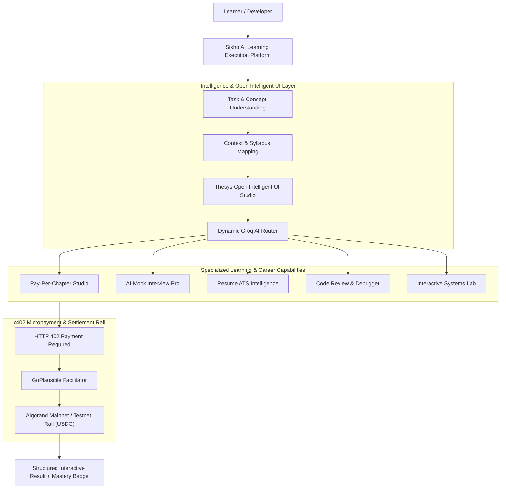

# Sikho AI — Decentralized AI Education & Career Intelligence Platform

**One Platform. Every Learning & Career Milestone.**  
*Understand → Structure → Simulate → Execute → Certify*

[](https://algorand.co)
[](https://x402.org)
[](https://www.typescriptlang.org/)
[](https://react.dev/)
[](https://fastapi.tiangolo.com/)
[](https://www.mongodb.com/)

> **AI-orchestrated education and career prep with pay-per-use execution.**  
> Sikho AI analyzes the learner's intent, compiles interactive architectural mental models (Open Intelligent UI), routes to specialized AI engines, executes task intelligence, and settles micro-transactions seamlessly through x402 on Algorand.

---

## What is Sikho AI?

Modern education and career preparation tools are locked behind expensive, rigid subscription walls. A developer or student preparing for an interview or studying a single complex topic (such as Distributed Load Balancing, Database Sharding, or Dynamic Programming) is often forced into:
- $39–$199/month all-or-nothing course subscriptions (Coursera, Udacity, Educative)
- Standalone resume-scanning paywalls ($25/scan)
- Proprietary mock interview subscriptions ($49/mo on LeetCode / Interviewing.io)
- Fragmented, static documentation that offers no interactive experimentation

**The problem is not a lack of educational content. The problem is payment and delivery friction:** learners are forced to pay for entire libraries when they only need to master one concept, and they are forced to read flat text instead of interacting with live system simulators.

**Sikho AI** (*"Sikho"* means *learn* in Hindi) is a decentralized AI education and career acceleration platform built to eliminate that barrier.

Instead of making learners discover, configure, and overpay for separate edtech services, Sikho AI provides a single unified interface that executes:

```
Learner Request
       ↓
Understand Intent
       ↓
Map Concept Context
       ↓
Synthesize Open Intelligent UI (Interactive Diagram + Failover Simulation)
       ↓
Route to Specialized LLM Tier
       ↓
x402 On-Chain Settlement (USDC on Algorand)
       ↓
Return Structured Interactive Mastery Result
```

Sikho AI exposes specialized learning and career capabilities as **pay-per-use and pay-per-chapter micro-services** protected by the open **x402 HTTP standard**, with instant payment settlement on **Algorand**.

---

## The Problem

EdTech platforms and AI career services have become fractured and cost-prohibitive.

A typical learner's workflow today looks like:

```
Search for a concept or interview topic
       ↓
Hit an aggressive $49/month paywall
       ↓
Enter credit card details & risk recurring charges
       ↓
Receive static, outdated text lessons
       ↓
Switch to another paid service for resume feedback
       ↓
Switch to a third tool for mock interview practice
       ↓
Manage separate credentials, wallets, and invoices
```

### The Core Inefficiencies
1. **Predatory Subscription Lock-in**: Charging students $200+ annually for courses when they only need 2 specific chapters.
2. **Passive, Static Reading**: Reading about architecture concepts (like Load Balancing or Caching) without interactive simulators leads to low concept retention.
3. **Fragmented Career Stack**: Mock interviews, resume screening, code debugging, and concept deep-dives exist in isolated silos.
4. **Global Payment Friction**: Millions of global developers lack international credit cards or get hit by cross-border exchange fees for micro-transactions.
5. **Token Inefficiency & Hallucinations**: Generic AI chatbots produce unstructured, unverified walls of text instead of verifiable learning modules.

Sikho AI resolves these friction points in one orchestrated, decentralized learning layer.

---

## The Solution

Sikho AI provides a unified AI execution and learning layer between the student and specialized AI models. The learner does not manage multiple subscriptions or juggle standalone tools.



The application handles the end-to-end pipeline: **instant access, zero monthly subscriptions, pay only fractions of a cent per concept.**

---

## Core Features

| Feature | Description | Pricing (USDC) |
| :--- | :--- | :--- |
| **Pay-Per-Chapter Learning** | Unlocks individual course chapters on-demand with permanent on-chain access badges. | `$0.005` |
| **Open Intelligent UI Studio** | Generates interactive architecture diagrams, live failover simulators, and 3D flashcards. | `$0.003` |
| **AI Mock Interview Pro** | Simulates role-based live technical interviews with real-time audio/text grading. | `$0.008` |
| **Resume ATS Intelligence** | Parses PDF/DOCX resumes against target job descriptions and generates gap analyses. | `$0.004` |
| **Live Architecture Simulator** | Interactive canvas with Frontend, Load Balancer, and Backend Servers with crash simulation. | `$0.003` |
| **Concept Deep Explanation** | Comprehensive breakdown of engineering trade-offs, case studies, and failure modes. | `$0.003` |
| **Code Review & Debugger** | Analyzes code snippets for bugs, security vulnerabilities, and optimal algorithmic time complexity. | `$0.005` |
| **Concept Quiz & Celebration** | Adaptive conceptual scenario quizzes with celebratory animations and score tracking. | Included |
| **Semantic Concept Cache** | Reuses verified prior model generations to reduce latency and token execution costs. | Free |
| **x402 Micropayments** | Native HTTP 402 protocol integration enabling frictionless wallet-based payments. | Protocol |
| **Algorand Settlement** | Instant, sub-cent on-chain settlement in USDC via the GoPlausible facilitator. | Rail |

---

## The Intelligence Layer & Open Intelligent UI

Sikho AI is significantly more than a wrapper around standard LLM endpoints. It incorporates an active **Intelligence & Generative UI Architecture**:

```
Raw Concept / Question
          ↓
  Task Understanding
          ↓
  Feynman Mental Model Compiler
          ↓
  Open Intelligent UI Generator
          ↓
  Interactive Dynamic Nodes & 3D Diagram Visuals
          ↓
  Semantic Cache Lookup
          ↓
  Groq High-Throughput Key Rotator (openai/gpt-oss-120b)
          ↓
  Interactive Learning Delivery
```

### 1. Feynman Mental Model Compiler
Translates complex computer science concepts into clear everyday analogies (e.g., explaining a Load Balancer as a grocery store cashier coordinator directing shoppers to open lanes).

### 2. Interactive Architecture Simulator
A live visual testbed rendering multi-tier infrastructure:
- **Frontend / Client Tier**: Dispatches simulated HTTP/TCP packets.
- **Central Gateway / Load Balancer**: Implements selectable routing algorithms (**Round Robin**, **Least Connections**, **IP Hash**).
- **Backend Server Cluster**: Displays real-time CPU load and active connection meters.
- **Live Failure Simulation**: Allows learners to click any backend instance to simulate a crash (🔴). The load balancer automatically evicts the dead server and reroutes traffic with zero dropped packets.
- **3D Isometric Architecture Diagram**: Visualizes high-availability server clusters with cloud database connections.

### 3. Concept Deep Explanation
Replaces abstract performance curves with actionable engineering insights:
- Architectural tier breakdown (Ingress, Gateway, Workers, Shared Redis Storage)
- Real-world production case studies (e.g. Netflix handling 300M+ concurrent streams)
- Engineering trade-offs matrix (Layer 4 vs Layer 7, Sticky Sessions vs Stateless JWT)
- Critical failure modes & defenses (Thundering herd on health checks, cascading outages)

### 4. 3D Flashcards & Adaptive Quizzes
Interactive 3D card deck with flip animations, hints, and scenario-based multiple-choice quizzes with celebratory feedback.

---

## System Architecture & x402 Payment Flow

Sikho AI uses the **x402 open payment protocol** as the access control mechanism for all premium learning and career capabilities.

On Algorand, x402 operates statelessly: when a client requests a protected chapter or interview session, the server issues an **HTTP 402 Payment Required** response detailing the payment parameters (price in USDC, asset ID, payment address, and network). The user signs the payment from their Algorand wallet (Pera, Defly, Kibisis), and the **GoPlausible facilitator** validates the transaction on-chain before the payload is unlocked.

```
Learner Browser / Client
       │
       │  1. POST /api/v1/ai/intelligent-ui
       ▼
Sikho AI Backend (Node.js / Express)
       │
       │  2. HTTP 402 Payment Required
       │     { payTo: "...", asset: "USDC", price: "$0.003", network: "Algorand" }
       ▼
Algorand Wallet (Pera / Defly)
       │
       │  3. Sign 0.003 USDC transaction
       ▼
GoPlausible Facilitator
       │
       │  4. Verify & Settle on Algorand Blockchain
       ▼
Algorand Ledger (Mainnet / Testnet)
       │
       │  5. 200 OK + Signed Payment Receipt Header
       ▼
AI Execution Engine (Groq Client Pool)
       │
       │  6. Execute openai/gpt-oss-120b & synthesize interactive schema
       ▼
Return Open Intelligent UI Interactive Studio Result
```

---

## Why Algorand?

Sikho AI chose **Algorand** as its settlement rail for x402 payments because micro-transactions for education require specific cryptographic guarantees:

```
Sikho AI
   │
   │ Orchestration & Learning Engine
   ▼
Interactive Capabilities
   │
   │ Access Gate
   ▼
x402 Protocol
   │
   │ Payment Settlement
   ▼
Algorand Blockchain
```

* **Instant Finality (< 3.3 seconds)**: Learners unlock chapters and submit quiz answers without waiting for block confirmations.
* **Sub-Cent Fees (< 0.001 ALGO)**: A $0.003 chapter unlock is not rendered useless by gas fees (unlike Ethereum where gas fees can exceed $5.00).
* **Native ASA Standard for USDC**: Eliminates complex smart-contract token wrappers; USDC transfers execute with native ledger speed.
* **Zero Forks & Absolute Finality**: Guarantees that paid chapter unlocks cannot be reversed or orphaned.

---

## AI Capabilities Breakdown

### 🎓 Education & Pay-Per-Chapter
* **Pay-Per-Chapter Unlock**: Decouples courses into standalone modular chapters priced between `$0.005` and `$0.010`. Unlocked chapters receive an on-chain verification badge.
* **Open Intelligent UI Studio**: Renders live interactive simulators, architecture diagrams, and 3D flashcards.
* **AI Concept Copilot**: Interactive Feynman-style Q&A assistant for instant doubt clarification.

### 💼 Career & Interview Intelligence
* **AI Mock Interview Pro**: Generates role-tailored technical questions across Frontend, Backend, DevOps, and Algorithms. Grades responses on technical accuracy, structure, and depth.
* **Resume ATS Scoring & Gap Analysis**: Upload resumes (PDF/DOCX) to extract technical competencies, calculate ATS match percentages against target job descriptions, and highlight missing keywords.
* **Career Roadmap Compiler**: Compiles customized month-by-month study roadmaps based on learner target positions.

### 💻 Engineering & Developer Tools
* **Code Reviewer**: Detects antipatterns, security vulnerabilities, and code smell in submitted snippets.
* **Runtime Debugger**: Identifies root causes of compile or runtime exceptions and provides fixed, documented code.
* **Build Studio & API Playground**: Allows developers to create, test, and monetize their own payment-gated x402 APIs.

---

## How Sikho AI Works

1. **Submit or Select**: The learner selects a course chapter or enters a technical question.
2. **Understand**: The engine extracts key concepts, difficulty level, and prerequisites.
3. **Synthesize**: Compiles mental models, interactive parameters, and flow stages.
4. **Challenge (x402)**: If accessing a paid feature, the backend returns an HTTP 402 challenge.
5. **Settle on Algorand**: The learner approves a sub-cent USDC payment settled via GoPlausible.
6. **Execute**: The Groq rotator executes completions using `openai/gpt-oss-120b` with JSON structure validation.
7. **Interactive Delivery**: Renders the complete **Open Intelligent UI Interactive Studio** with live node simulations, deep explanations, flashcards, and quizzes.
8. **Permanent Access**: Unlocked chapters remain accessible in the Learner Dashboard.

---

## Technology Stack

| Layer | Technology | Role |
| :--- | :--- | :--- |
| **Frontend** | React 18, TypeScript, Vite | High-performance interactive single-page application |
| **Styling & UI** | Tailwind CSS, Framer Motion, Lucide | Modern glassmorphic interface and micro-animations |
| **Backend (Node.js)** | Express, TypeScript, Hono | x402 middleware, payment challenges, and Groq rotator |
| **AI Engine (Python)** | FastAPI, Groq SDK, PyPDF, python-docx | Resume parsing, text extraction, and interview analysis |
| **AI Models** | Groq (`openai/gpt-oss-120b`, `llama-3.3-70b`) | High-speed structured JSON synthesis with key rotation |
| **Database** | MongoDB | User profiles, course curricula, and session history |
| **Payment Protocol** | x402 | Decentralized HTTP 402 Payment Required specification |
| **Facilitator** | GoPlausible | On-chain payment verification and settlement facilitation |
| **Settlement Rail** | Algorand (Mainnet / Testnet) | Fast-finality ledger settling USDC transactions |
| **Deployment** | Vercel (Frontend) + Render (Backends) | Global edge hosting with automated continuous deployment |

---

## Project Structure

```
sikho-AI/
│
├── README.md                                 # Complete system documentation
├── render.yaml                               # Render auto-deploy blueprint config
│
├── X402-Usecase/projects/X402-Usecase/       # React + Vite Frontend (Vercel)
│   ├── public/
│   │   ├── architecture_diagram.jpg          # Generated 3D Isometric Architecture Diagram
│   │   └── favicon.ico
│   ├── src/
│   │   ├── components/
│   │   │   └── intelligent-ui/               # Open Intelligent UI Studio Components
│   │   │       ├── types.ts                  # Type definitions for schemas
│   │   │       ├── IntelligentUIContainer.tsx# Main tabbed studio container
│   │   │       ├── InteractiveArchitectureSimulator.tsx # Combined node simulator + flow stepper
│   │   │       ├── ConceptExplanation.tsx    # In-depth architectural trade-offs & breakdown
│   │   │       ├── FlashcardDeck.tsx         # 3D interactive flashcard deck
│   │   │       ├── ConceptQuizCelebration.tsx# Scenario quiz with confetti celebration
│   │   │       └── IntelligentAICopilot.tsx  # Feynman Q&A assistant
│   │   ├── pages/
│   │   │   ├── LearnerDashboard.tsx          # Unlocked chapters & Interactive Studio launcher
│   │   │   ├── CourseDetail.tsx              # Curriculum list with studio previews
│   │   │   ├── InterviewPrep.tsx             # AI mock interview simulator
│   │   │   ├── ResumeIntelligence.tsx        # PDF resume parsing & ATS gap scoring
│   │   │   ├── BuildStudio.tsx               # Developer API builder
│   │   │   └── ApiPlayground.tsx             # Live x402 API testing suite
│   │   └── config/
│   │       └── api.ts                        # Unified API endpoints catalogue
│   └── package.json
│
├── x402-demo-server/                         # Node.js + TypeScript Backend (Render)
│   ├── config/
│   │   ├── env.ts                            # Environment variables & Algorand constants
│   │   └── index.ts                          # Centralized server configuration
│   ├── controllers/
│   │   ├── ai/
│   │   │   ├── intelligentUi.controller.ts   # Open Intelligent UI schema generator
│   │   │   ├── mvp.controller.ts             # Specialized learning & career MVP controllers
│   │   │   └── index.ts                      # Legacy explain & course generator routing
│   │   └── interview/
│   │       └── interviewPro.controller.ts    # Interview Pro controller
│   ├── middlewares/
│   │   ├── x402.middleware.ts                # x402 payment challenge & verification logic
│   │   └── auth.middleware.ts                # JWT authentication middleware
│   ├── services/
│   │   └── ai/
│   │       └── aiRotator.ts                  # Groq client pool rotator with key deduplication
│   ├── routes/
│   │   ├── ai.routes.ts                      # All AI learning & intelligent UI routes
│   │   ├── x402.routes.ts                    # Payment verification routes
│   │   └── index.ts                          # Main express router aggregator
│   └── package.json
│
└── interview_pro/backend/                    # Python FastAPI AI Engine (Render)
    ├── main.py                               # FastAPI application & Groq pipeline
    ├── requirements.txt                      # Python dependencies (Groq, pypdf, python-docx)
    └── uploads/                              # Temporary file upload staging
```

---

## Getting Started

### Prerequisites
- **Node.js**: v18.x or v20.x
- **Python**: 3.10+
- **MongoDB**: Local instance or MongoDB Atlas connection string
- **Groq API Key**: At least one active key (`GROQ_API_KEY_1`)
- **Algorand Wallet**: Pera Wallet or Defly Wallet with Testnet/Mainnet USDC

---

### Step 1: Clone Repository
```bash
git clone https://github.com/krishnaaurora/sikho-AI.git
cd sikho-AI
```

### Step 2: Configure & Start Node Backend
```bash
cd x402-demo-server
npm install

# Create environment configuration
cp .env.example .env
```

Ensure your `.env` contains:
```env
PORT=4021
NODE_ENV=development
MONGODB_URI=mongodb://localhost:27017/sikho-ai
JWT_SECRET=your_secret_key
GROQ_API_KEY_1=gsk_...
GROQ_API_KEY_2=gsk_...
GROQ_API_KEY_3=gsk_...
GROQ_RESUME_KEY_1=gsk_...
AVM_ADDRESS=2RIRIX5XK6GWK7LOXDAYIDTN4IYDVNRDJFXR4TJCLYIM72A3EF2UQPROQY
FACILITATOR_URL=https://facilitator.goplausible.xyz
X402_NETWORK=algorand:SGO1GKSzyE7IEPItTxCByw9x8FmnrCDexi9/cOUJOiI=
```

Start the server:
```bash
npm run dev
# Server running at http://localhost:4021
```

### Step 3: Configure & Start Python AI Engine
```bash
cd ../interview_pro/backend
python -m venv venv
source venv/bin/activate  # On Windows: .\venv\Scripts\activate
pip install -r requirements.txt

# Start FastAPI server
uvicorn main:app --reload --port 8000
# FastAPI running at http://localhost:8000
```

### Step 4: Configure & Start React Frontend
```bash
cd ../../X402-Usecase/projects/X402-Usecase
npm install

# Start Vite dev server
npm run dev
# Application live at http://localhost:5173
```

---

## Testing & Verification

### Backend Typechecking & Health
```bash
cd x402-demo-server
npx tsc --noEmit
```

### Frontend Production Build
```bash
cd X402-Usecase/projects/X402-Usecase
npm run build
```

---

## Built for the Global x402 Challenge

Sikho AI was built specifically for the **Global x402 Challenge by Algorand**, exploring how decentralized micropayments can disrupt the legacy $300B online education and career preparation market.

By decoupling full-course subscriptions into **sub-cent on-chain chapter unlocks** and pairing them with **Thesys-inspired Open Intelligent UI interactive studios**, Sikho AI proves that micro-transactions on Algorand can unlock seamless, pay-as-you-learn educational accessibility for students and developers worldwide.

---

## Roadmap

### Current Version (v1.0)
- [x] Pay-Per-Chapter learning flow with on-chain unlock badges
- [x] Open Intelligent UI Studio (Live architecture simulator, 3D flashcards, Feynman analogies)
- [x] Interactive node failover simulation (Click-to-crash backend server testing)
- [x] AI Mock Interview Pro with question bank generation
- [x] Resume ATS scoring & job gap extraction (PDF/DOCX)
- [x] Multi-key Groq client pool rotator (`openai/gpt-oss-120b`)
- [x] Full x402 payment challenge, verification, and Algorand settlement pipeline

### Next Iteration (v1.1)
- [ ] Real-time audio voice analysis for technical mock interviews
- [ ] Multi-region failover simulator with distributed database replication
- [ ] On-chain NFT completion certificates issued automatically upon chapter mastery
- [ ] Dynamic developer bazaar enabling creators to publish and monetize their own course chapters

---

## Security Best Practices

- **Never Commit Secrets**: Never commit `.env`, `.env.testnet`, `.env.mainnet`, private seed phrases, or database connection strings.
- **Stateless Payment Validation**: All x402 payment verifications are validated against on-chain transaction hashes via the GoPlausible facilitator before granting payload access.
- **Rate-Limiting & Rotating Key Pools**: AI client rotation automatically bypasses depleted or rate-limited keys without service disruption.

---

## License

Distributed under the MIT License. See `LICENSE` for more information.

---

**Sikho AI** — *One Platform. Every Learning & Career Milestone.*  
Built with Algorand · x402 · TypeScript · React · FastAPI · Groq
